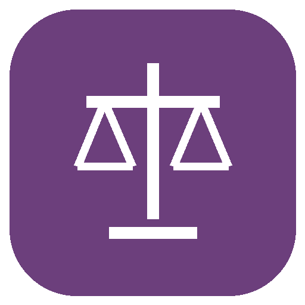

# BOE Impact

## Ve qué cambió. Entiende qué revisar.

Compara artículos del BOE entre dos fechas y separa el cambio textual de sus posibles implicaciones prácticas.

**Para:** Asesorías y profesionales que trabajan con normas españolas.

**Fuente:** BOE · **Sin cuenta adicional ni API key** · **Python 3.11+** · **MIT**

### Qué obtienes

- Texto anterior y posterior con fechas de cada versión.
- Diferencias reproducibles, no solo un resumen.
- Interpretación práctica separada de la redacción oficial.

### Pruébalo con una pregunta

> Compara un artículo entre dos fechas y muéstrame el antes, el después y la fuente.

También: “Revisa esta norma: distingue publicación, entrada en vigor y régimen transitorio.”

[Ver el informe de ejemplo](examples/demo.md) · [Código de la página del producto](docs/index.html) · [Flujo completo](skills/boe-impact/references/workflow.md)

La demostración es una **captura guardada de fuentes oficiales**, no una consulta actual. Conserva fecha, enlaces y alcance.

## Instalar el versión 0.4.0 en Claude Code

```text
/plugin install boe-impact --marketplace https://github.com/samihalawa/boe-impact.git#release/v0.3.0-local
```

O desde terminal:

```bash
claude plugin marketplace add https://github.com/samihalawa/boe-impact.git#release/v0.3.0-local
claude plugin install boe-impact@boe-impact
```

Después, pregunta en lenguaje natural o invoca `/boe-impact:boe-impact`.

## Instalar en Codex

```bash
codex plugin marketplace add https://github.com/samihalawa/boe-impact --ref release/v0.3.0-local
codex plugin add boe-impact@boe-impact
```

El paquete declara su MCP local en `mcp.json`; Claude utiliza `.mcp.json`. La instalación local y la disponibilidad en un directorio público son estados diferentes. OpenAI limita la publicación pública de MCP locales a organizaciones habilitadas; una carga privada no demuestra esa habilitación ni crea una conexión web/móvil.

## Instalar en Grok Build

```bash
grok plugin install samihalawa/boe-impact@release/v0.3.0-local
```

Grok utiliza la configuración compatible `.mcp.json`; conserva el mismo MCP local y sus límites. La entrada en el catálogo oficial requiere la aceptación de sus mantenedores.

## Ejemplo sin conexión

Pide al MCP declarado `boe-impact` la herramienta `boe_impact_demo`. El ejemplo conserva su fecha y sus fuentes; nunca se presenta como una consulta actual.

## Consulta e informe

El anfitrión invoca `boe_find_articles` con los argumentos descritos en [Esquemas MCP](skills/boe-impact/references/mcp-tools.json). Para obtener un informe determinista, utiliza `boe_impact_report` con la operación elegida, sus argumentos y el formato `markdown`, `html` o `json`. La herramienta devuelve texto; no guarda archivos. El anfitrión puede guardar el resultado únicamente en la ruta solicitada por el usuario.

## Dónde funciona

| Entorno | Comportamiento |
|---|---|
| Claude Code o escritorio Codex/OpenAI compatible, MCP habilitado y Python 3.11+ | Proceso MCP local declarado, adaptadores e informes. |
| Anfitrión sin MCP local | Solo navegación/archivos nativos autorizados; no se ejecutan scripts como alternativa ni se afirma haber ejecutado el adaptador. |
| Sin red | Herramienta de ejemplo guardado; no se inventan datos actuales. |

No hay servidor público, escucha de red ni instalación de dependencias. El único proceso de ejecución del plugin es el MCP declarado. Las instrucciones de desarrollo están separadas del flujo de uso.

## Alcance real

La consolidación es informativa. No decide automáticamente aplicabilidad, régimen transitorio o conformidad legal. Verifica la publicación original para decisiones jurídicas.

## Verificación

[Desarrollo y pruebas](DEVELOPMENT.md). Las comprobaciones de instalación y protocolo no equivalen a aprobación del directorio ni a aceptación en todos los anfitriones.

[Mejoras y crítica](CHANGELOG.md) · [Evidencia versionada](evidence/) · [Revisión de Claude](SUBMISSION.md). Los tests no equivalen a adopción. `ci/validate.yml` es una plantilla inactiva.

**English:** An independent workflow for Spanish official data, with a self-contained Python adapter, offline example and readable reports. Answer language follows the user.

**Sami Halawa** · Software independiente; sin afiliación oficial. [Privacidad](PRIVACY.md) · [Condiciones](TERMS.md) · [Soporte](SUPPORT.md) · [Seguridad](SECURITY.md).

## Datos enviados a servicios externos

Las consultas en vivo envían únicamente los parámetros públicos necesarios de la consulta a los servicios oficiales identificados en [Fuentes y endpoints](skills/boe-impact/references/sources.md). El proveedor recibe esos parámetros y la dirección de red del entorno que ejecuta la consulta. No se envían credenciales, adjuntos, perfiles personales ni el historial de conversación. Estos accesos se realizan desde el MCP local declarado o las herramientas nativas autorizadas del anfitrión; no existe un conector público alojado. Los proxies con credenciales heredadas se rechazan antes de realizar una conexión.

Las respuestas oficiales pueden contener nombres, direcciones u otros datos personales públicos. La caché local es solo de memoria, durante un máximo de cinco minutos mientras se ejecuta el proceso. Los resultados pueden permanecer en la conversación o en informes guardados explícitamente por el usuario; su conservación depende del anfitrión y del usuario. El editor no opera un servicio que reciba o almacene estos datos. Consulta [Privacidad](PRIVACY.md) para los detalles y los límites de reutilización.

## Identidad visual

Un símbolo sencillo identifica esta función y una pequeña bandera española marca el borde. No es un escudo ni un sello oficial, y no implica afiliación gubernamental. [Logo de ficha](assets/logo.png) · [Icono compacto](assets/icon.png).

## Docker

[Container build, stdio setup and offline examples](DOCKER.md). The container uses the same 0.4.0 adapters and does not create a hosted MCP endpoint.
