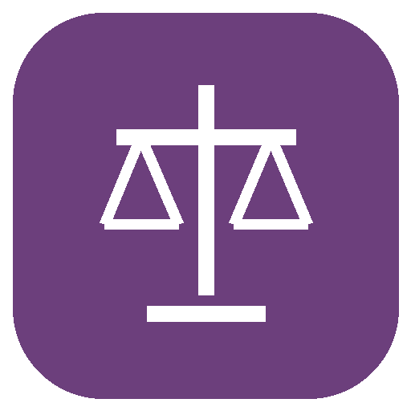

# BOE Impact

Localiza identificadores de artículos en una norma consolidada del BOE por título o texto; la comparación y aplicabilidad requieren revisión documental adicional.

**Versión 0.6.3 · Conector MCP alojado e instrucciones complementarias · Sami Halawa · MIT**

## Instalación y uso

```bash
/plugin install boe-impact --marketplace samihalawa/2026-MASTER-Marketplace-Plugins-Connectors-etc
```


Instala el paquete en un anfitrión compatible con plugins y MCP remoto. La configuración incluida conecta `https://aiplugins.megawebs.com/mcp/boe-impact` mediante Streamable HTTP y expone `find_spanish_law_articles`. No necesitas Python local, instalar dependencias ni proporcionar una clave del editor. La disponibilidad de la conexión depende del anfitrión y de la fuente pública.

> Localiza los artículos sobre contratos menores en BOE-A-2017-12902.

- Busca el artículo 118 en BOE-A-2017-12902 y conserva el enlace oficial.
- Busca contratos en el texto de BOE-A-2017-12902, no solo en títulos.

Lee [la habilidad](skills/boe-impact/SKILL.md) para el procedimiento, [las fuentes](skills/boe-impact/references/sources.md) y [el contrato de acceso](skills/boe-impact/references/runtime.md). La herramienta realiza la consulta acotada descrita; la lectura de documentos, interpretación y creación de archivos usan capacidades adicionales del anfitrión. Conserva los identificadores, enlaces, fechas y límites realmente devueltos.

## Alcance

No presenta solicitudes u ofertas, no firma, no compra, no consulta datos protegidos ni activa vigilancia. Una respuesta parcial o fallida no prueba ausencia de registros. No se garantiza elegibilidad, resultado jurídico, titularidad ni financiación.

Los [ejemplos guardados](examples/demo.md) son capturas históricas de versiones anteriores, no consultas actuales. El historial de 0.5.0 conserva la edición de instrucciones; 0.6.0 añade una conexión remota explícita y no reetiqueta esas capturas. La aprobación en un directorio se verifica por separado.

[Producto e instalación](https://aiplugins.megawebs.com/plugins/boe-impact) · [Privacidad](https://aiplugins.megawebs.com/plugins/boe-impact/privacy) · [Condiciones](https://aiplugins.megawebs.com/plugins/boe-impact/terms) · [Soporte](https://aiplugins.megawebs.com/plugins/boe-impact/support)
